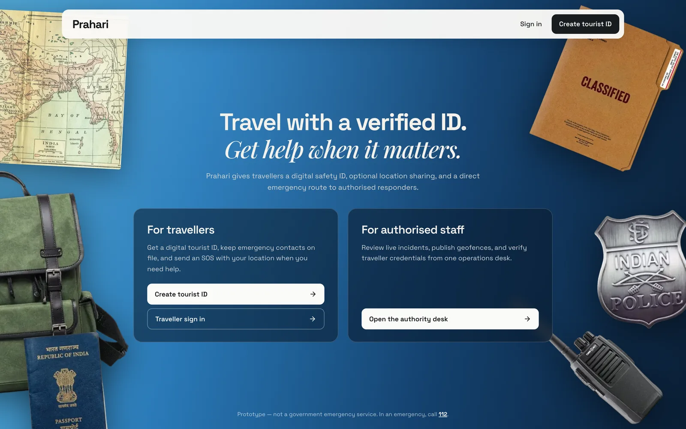
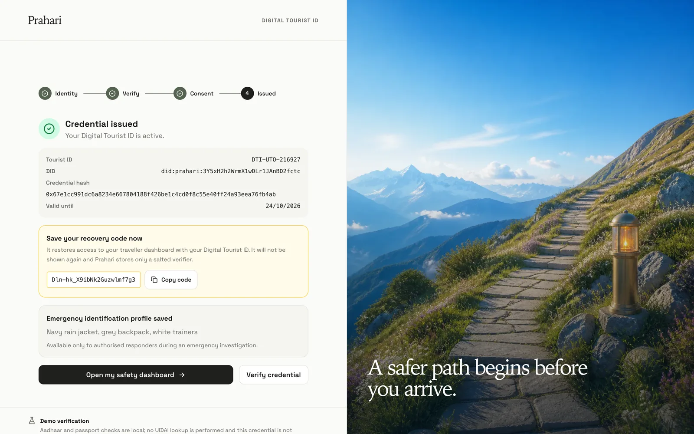
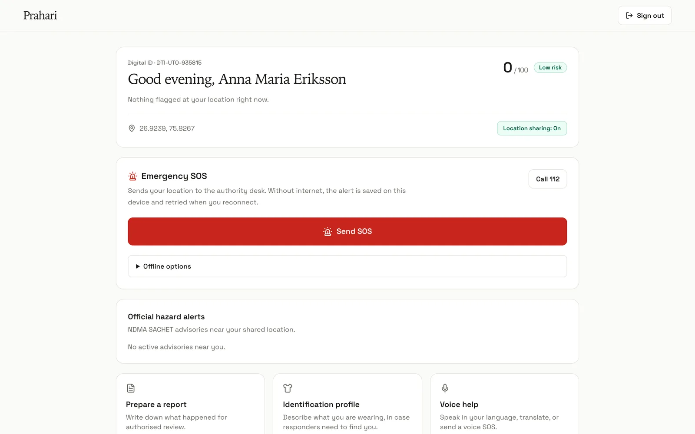
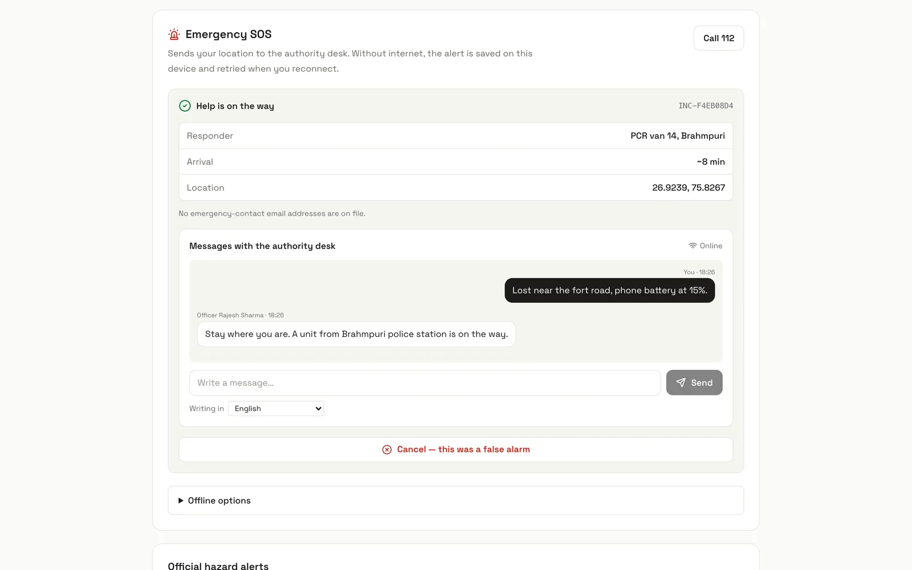
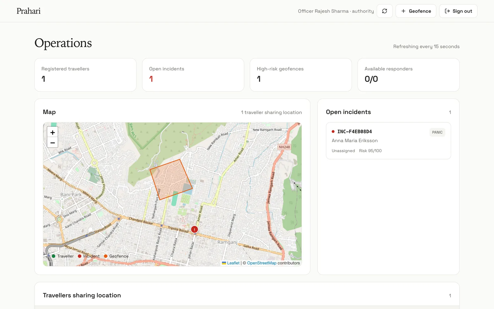
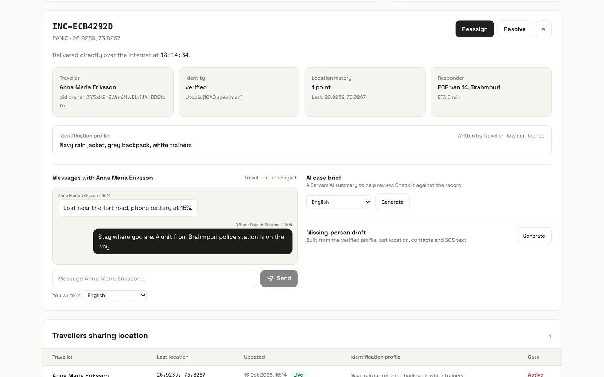
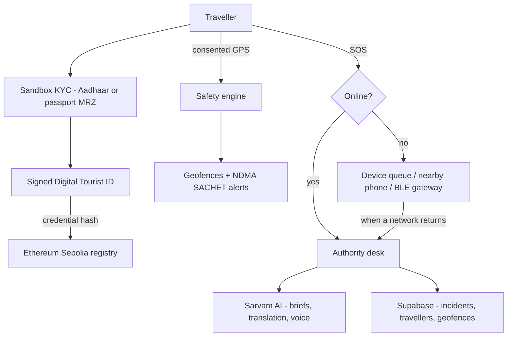

<div align="center">

# Prahari

**A safety ID and SOS line for travellers in India.**

Verified digital tourist IDs, location-aware hazard alerts, and an emergency route to authorised responders that still works when the network doesn't.

</div>

---

## About

Prahari gives every traveller a signed Digital Tourist ID and a one-tap SOS, and gives authorised staff a single desk to see incidents, publish risk zones and talk to the people who need help.

- **Digital Tourist ID** - Sandbox Aadhaar (Verhoeff + OTP) or passport MRZ check, then an Ed25519-signed credential with a `did:prahari:` identifier and a QR code that verifies without revealing personal data.
- **Blockchain anchoring** - Only the credential hash is anchored on Ethereum Sepolia by a server wallet. No personal data goes on-chain and no traveller wallet is needed.
- **Safety assessment** - With consent, browser GPS is checked against authority geofences, official NDMA SACHET hazard alerts, nearby incidents, time of day and speed. High scores go to a human for review; nothing is dispatched automatically.
- **SOS that survives bad signal** - Online, the SOS goes straight to the authority desk and emergency contacts get an email with a map link. Offline, it is saved on the device and retried, and can be handed to a paired nearby phone (WebRTC) or a BLE relay gateway. Relayed packets are signed, so relays can carry them but not alter them.
- **Live SOS status** - The desk assigns a unit and an ETA, chats with the traveller, and resolves the case; the traveller's SOS card updates as it happens, even after a reload.
- **Multilingual help** - Sarvam AI speech-to-text, text-to-speech and translation across 11 Indian languages plus English, for travellers and for officer-to-traveller chat.
- **Case tools for staff** - AI case briefs, missing-person drafts, a clothing-based identification profile (the photo is never stored), and review of traveller incident reports.
- **Offline safety pack** - Nearby hospitals, police, helplines and guidance for a chosen area, saved on the device.

> Prahari is a prototype built for Smart India Hackathon 2026. It is not a government service and is not connected to police, UIDAI or 112. Identity checks are sandboxed.

## Screenshots

|                                                                                                                   |                                                                                                              |
| :---------------------------------------------------------------------------------------------------------------: | :----------------------------------------------------------------------------------------------------------: |
|                 <br><sub>Landing page</sub>                 |   <br><sub>Digital Tourist ID issued</sub>   |
| <br><sub>Traveller dashboard - safety score, SOS, hazard alerts</sub> | <br><sub>Live SOS status - unit assigned, chat with the desk</sub> |
|   <br><sub>Authority desk - map and incident queue</sub>   |  <br><sub>Incident review - assign help, reply, AI tools</sub>  |

---

## Architecture



---

## Tech Stack

| Layer             | Technology                                       |
| :---------------- | :----------------------------------------------- |
| Framework         | Next.js 15 (App Router), React 19, Tailwind CSS  |
| Database          | Supabase (PostgreSQL, Realtime)                  |
| Identity          | Ed25519 credentials, Solidity registries (Hardhat, Sepolia) |
| AI                | Sarvam AI (translation, briefs, speech), OpenAI (clothing profile) |
| Maps and hazards  | Leaflet + OpenStreetMap, NDMA SACHET feed        |
| Offline delivery  | IndexedDB queue, WebRTC data channels, Web Bluetooth |

---

## Getting Started

### Prerequisites

- Node.js 22+ and pnpm
- Optional: a [Supabase](https://supabase.com/) project, a [Sarvam AI](https://www.sarvam.ai/) key, and a Sepolia RPC URL

### Setup

```bash
git clone https://github.com/Arav-Arun/Prahari.git
cd Prahari
pnpm install
cp .env.example apps/web/.env.local
pnpm identity:keygen
```

Paste the generated `IDENTITY_SIGNING_KEY` and a random `SESSION_SECRET` into `apps/web/.env.local`, then:

```bash
pnpm dev
```

Open [localhost:3000](http://localhost:3000).

Without Supabase configured, the app runs on in-memory records, so you can try every flow locally. To persist data, run `supabase/schema.sql` in the Supabase SQL editor. `GET /api/health` reports what is configured.

### Optional services

Each of these switches on one feature; the rest of the app works without it. See [`.env.example`](.env.example) for every variable.

| Feature                         | Variables                                                                  |
| :------------------------------ | :------------------------------------------------------------------------- |
| Durable storage and live updates | `NEXT_PUBLIC_SUPABASE_URL`, `SUPABASE_SERVICE_ROLE_KEY`, `SUPABASE_REALTIME_JWT_SECRET` |
| Emergency-contact email         | `RESEND_API_KEY`, `EMERGENCY_FROM_EMAIL`                                   |
| Translation, voice, case briefs | `SARVAM_API_KEY`                                                           |
| Clothing profile from a photo   | `OPENAI_API_KEY`                                                           |
| Credential anchoring on Sepolia | `ALCHEMY_SEPOLIA_URL`, `DEPLOYER_PRIVATE_KEY`, `SEPOLIA_*_REGISTRY_ADDRESS` |
| BLE relay gateway               | `PRAHARI_MESH_GATEWAY_KEY` (see [tools/ble-gateway](tools/ble-gateway/README.md)) |

### Accounts

Travellers create their own ID at `/onboarding`; the passport path has a "Generate an ICAO specimen passport" button for testing.

In development, the sign-in page has **Authority** and **Responder** buttons for built-in demo staff accounts (password `Prahari@123`). A production build hides them unless `NEXT_PUBLIC_DEMO_ACCOUNTS=true`. For real staff, run `pnpm staff:create <email> "<name>" authority` and paste the printed SQL into Supabase.

### Scripts

```bash
pnpm test                       # unit tests (credentials, safety engine, SOS mesh)
pnpm lint
pnpm mesh:demo                  # walks a signed SOS across two relays in the terminal
pnpm staff:create               # prints SQL for a staff account
pnpm contract:compile
pnpm contract:deploy:sepolia
```

---

## Project Structure

```
apps/web/
├── app/
│   ├── api/              Route handlers: auth, KYC, identity, incidents, locations, geofences, chat, AI
│   ├── authority/        Authority desk
│   ├── citizen/          Traveller dashboard
│   ├── onboarding/       Identity verification and ID issue
│   ├── login/            Sign-in
│   └── verify/[did]/     Public credential check
├── components/           authority/, tourist/, maps/, offline/
└── lib/
    ├── auth/             Sessions and route guards
    ├── identity/ kyc/    Credentials, DIDs, Aadhaar and MRZ checks
    ├── blockchain/       Sepolia anchoring
    ├── services/         Hazards, notifications, translation, drafts
    └── sos-mesh/         Signed SOS packets, offline queue, WebRTC and BLE transports

packages/contracts/       Identity and incident registries (Solidity) and deploy script
supabase/schema.sql       Database schema
tools/ble-gateway/        Optional Raspberry Pi BLE relay
scripts/                  Key generation, staff accounts and the mesh demo
```
